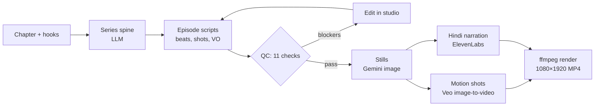

# कथा Reels — AI micro-drama studio for Indian mythology

Turns a chapter of the Ramayana, Mahabharata or Panchatantra into a binge-able series of Hindi 9:16 reels.
A multi-step AI pipeline writes, illustrates, narrates and renders each episode, and an automated QC layer
flags any reel that breaks the format.

**Product, pipeline design and prompts:** [Ankit Banerjee](https://www.linkedin.com/in/ankit-b-583768aa/)

## Why it exists

China's short-drama (*duanju*) apps showed that 60–90 second episodes, with a hook in the first 3 seconds and
a cliffhanger at the end, keep people watching episode after episode. Devotional stories are some of India's
most-watched content but are mostly told as long, slow videos. Katha Reels applies the short-drama format to
the source texts.

## What it does

- **Catalog:** 48 chapters across 6 works, each with a Hindi summary, its canonical source and pre-identified dramatic hooks.
- **Script engine:** writes a series spine, then each episode in five beats (hook → friction → escalation → spike → cut), drawing on 12 hook types and 8 cliffhanger types.
- **Quality control:** 11 automated checks on every reel; 6 are blockers, such as "the hook lands by 3 s" and "the episode cuts before resolution".
- **Production:** one still per shot (Gemini image), optional Veo image-to-video motion shots, one continuous Hindi narration take (ElevenLabs), and an ffmpeg render to 1080×1920 with correctly shaped Devanagari captions.
- **Human in the loop:** every beat, voice-over line and shot prompt can be edited before anything is generated.
- **Model-agnostic:** scripts run on Anthropic or Azure OpenAI; images on Gemini, OpenAI or fal.

## How it works



## Stack

Next.js · TypeScript · Anthropic / Azure OpenAI · Gemini image · Veo 3.1 · ElevenLabs · ffmpeg (libass + HarfBuzz) · Docker on Render

---

# Running it


## Quick start

```bash
cp .env.example .env.local   # then fill in your keys
npm install
npm run dev                  # http://localhost:4321
```

Before spending any credits, verify your ffmpeg setup:

```bash
curl -X POST http://localhost:4321/api/dev/selftest
```

That renders a synthetic 30s reel from placeholder frames and reports the ffprobe output.
If it returns `"ok": true` with `1080×1920 / h264 / 30fps`, the whole render path works.

---

## Keys

| Var | What it drives | Required |
|---|---|---|
| `KATHA_PASSWORD` | Password for the hosted app (any username). Production stays locked until it is set; `/api/dev/*` is disabled in production | in production |
| `SCRIPT_PROVIDER` | `anthropic` or `azure` — who writes the scripts | yes |
| `ANTHROPIC_API_KEY` | Series spine + episode scripts + storyboards | if anthropic |
| `KATHA_SCRIPT_MODEL` | default `claude-opus-5` | no |
| `AZURE_OPENAI_ENDPOINT` / `_API_KEY` / `_DEPLOYMENT` | Azure OpenAI alternative | if azure |
| `AZURE_OPENAI_API_STYLE` | `responses` (default) or `chat` — which Azure surface | no |
| `ELEVENLABS_API_KEY` | Hindi narration | for audio |
| `ELEVENLABS_VOICE_ID` | Hindi-capable voice | no |
| `IMAGE_PROVIDER` | `gemini` \| `openai` \| `fal` | for visuals |
| `GEMINI_API_KEY` / `OPENAI_API_KEY` / `FAL_KEY` | whichever provider you picked | — |
| `GEMINI_IMAGE_MODEL` | `gemini-3-pro-image` (default) or `gemini-3.1-flash-image` (cheaper) | no |
| `GEMINI_IMAGE_SIZE` | `2K` (default) = 1536x2752 source for the Ken Burns zoom | no |
| `ELEVENLABS_VOICE_ID` / `_KIDS` | per-mode Hindi narrators | no |
| `VEO_ENABLED` | `true` turns on Veo for flagged motion shots | no |

The header banner on the home page shows which engines are actually wired up.

---

## The reel structure

Encoded once in `lib/microdrama.ts` — the script prompt, the QC validator and the monitor UI
all read from the same constants, so the format can't drift between them.

**Five beats per episode**

| Beat | हिन्दी | Share | Rule |
|---|---|---|---|
| `hook` | धमाका | 0–6% | Open mid-crisis. *bào diǎn* (爆点). Zero backstory in the first 3s. |
| `friction` | टकराव | 6–45% | Two forces, one space, under pressure. Conflict shown, never explained. |
| `escalation` | चढ़ाव | 45–72% | Raise the cost. An ally turns, a deadline closes. |
| `spike` | पलटवार | 72–90% | Reversal that re-prices everything. **Must read with the sound off.** |
| `button` | कट | 90–100% | Cut *before* resolution. Blade raised, not fallen. |

**12 hook types** — each maps a duanju trope to its katha equivalent
(प्रतिज्ञा ↔ 立誓, अपमान ↔ 打脸 face-slap, गुप्त पहचान ↔ 马甲, अंतिम घड़ी ↔ 倒计时 …).

**8 cliffhanger types** — never the same type twice in a row.

**Series arc** across a chapter's episodes: premise → escalation → darkest (60%) → resolution,
with the last episode still handing off rather than resolving.

See `/method` in the running app for the full rendered spec.

---

## Automated QC

Runs on every generated reel and again on every save. Blockers are hard format violations;
warnings are craft problems.

- `hook_under_3s` — hook beat closes by 3.0s **(blocker)**
- `has_button` — ends on a cliffhanger, not a resolution **(blocker)**
- `duration_in_range` — 45–90s **(blocker)**
- `no_cold_exposition` — no "बहुत समय पहले" in the opening **(blocker)**
- `loop_opened` — plants a question it does not answer **(blocker)**
- `shots_cover` — shots tile the runtime with no gap or overlap **(blocker)**
- `vo_fits` — Hindi VO fits its beat at 2.6 words/sec ±15%
- `mute_legible` — the spike is described as a visual, not a line
- `loop_closed` — answers the previous episode's question in its hook
- `shot_pace` — no shot longer than 6s
- `text_safe_area` — on-screen cards ≤7 words

---

## Pipeline

```
chapter  ──▶ generateSpine()      one Claude call  → episode spine (arc, hooks, loops)
         ──▶ generateEpisode()    one call per ep  → beats, shots, VO, publish copy
         ──▶ buildVisuals()       one image per shot (+ ≤2 Veo shots if enabled)
         ──▶ buildVoice()         ElevenLabs, one continuous take per episode
         ──▶ buildRender()        ffmpeg → 1080×1920 H.264 + AAC
         ──▶ /api/download/:id?dl=1
```

Long steps run as background jobs (`lib/jobs.ts`); the UI polls `/api/jobs/:id` and streams
episodes into the board as the writer finishes them.

### Render details

- Gemini's native image models use `generateContent` with an IMAGE response modality, **not** Imagen's `:predict` shape, and return JPEG
- Stills are generated at 2K (1536x2752), above the 1080x1920 target, because the Ken Burns move zooms *into* the frame
- Ken Burns per still via `zoompan`, driven by each shot's `motion` field
- Veo clips are cover-cropped to 9:16 and cut to their slot. Two API quirks worth knowing:
  `personGeneration` is rejected by `predictLongRunning` and must be omitted, and Veo returns
  **720x1280** (upscaled to 1080x1920 by the renderer) unless you set `VEO_RESOLUTION`.
  Veo runs *after* all stills exist and is seeded with the shot's own still (image-to-video),
  which is what keeps a motion shot from drifting into glossy CGI next to painterly frames.
  Measured: ~89s per clip.
- If narration exists it is **the clock** — the visual timeline is scaled so the last word
  and the last frame land together
- Captions burn through **libass + harfbuzz**, not `drawtext` — drawtext has no complex-text
  shaping and 